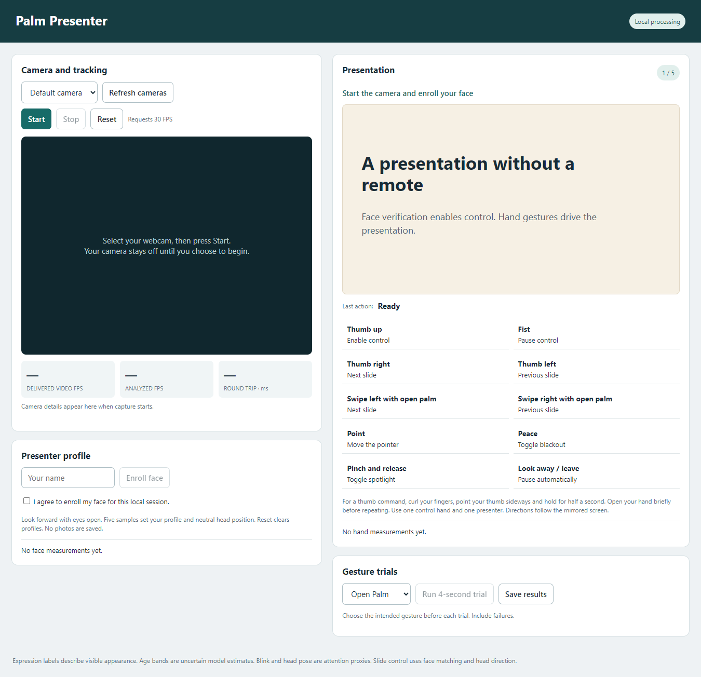

# Palm Presenter

Control a five-slide presentation with a webcam. Give a thumbs-up to take control, point your thumb sideways to change slides, or use your index finger as a pointer. A live preview shows which gesture the controller sees and which action it took.



## Run locally

Use Python 3.12 and a webcam. From the project directory on Windows:

```powershell
py -3.12 -m venv .venv
.\.venv\Scripts\python.exe -m pip install -r requirements.txt
.\.venv\Scripts\python.exe run.py
```

The first launch downloads approximately 100 MB of pretrained models and verifies each file against its SHA-256 digest. Later launches reuse the local cache. The app opens a browser tab on this computer. Keep the terminal open while presenting. If the tab doesn't open automatically, copy the session link printed in the terminal into Chrome or Edge.

1. Select a camera, press **Start**, and allow camera access. The preview is mirrored.
2. Enter a display name, tick the consent box, and choose **Enroll face**. Look forward with your eyes open while the controller takes five samples.
3. Keep one face and one control hand in view. Hold **Thumb Up** until the status reads **Control enabled**. Try **Thumb Right** to move from slide 1 to slide 2.

## Controls

| Gesture in the preview | Action |
| --- | --- |
| Thumb up / closed fist | Enable / pause |
| Thumb right / thumb left | Next / previous slide |
| Open-palm swipe left / right | Next / previous slide |
| Point | Move the pointer |
| Peace sign | Toggle blackout |
| Pinch | Toggle spotlight |

For the sideways-thumb controls, curl your fingers and hold the pose for about half a second. Open your hand briefly before repeating. A held thumb advances one slide. The sideways poses give you an alternative when motion blur or a low analysis rate makes swiping difficult. The controller operates its built-in deck. Edit `SLIDES` in `logic.py` to change the slide titles and text.

## What runs on your machine

The browser captures the webcam and sends the latest frame to the Python process on the loopback interface. OpenCV and MediaPipe locate faces and hands. The controller combines face matching, head direction and hand landmarks to decide when to change slides. It reports delivered video FPS and analysis FPS separately so you can see how smoothly the camera displays and how often a command can be evaluated.

Enrollment templates live in memory. **Stop** releases the webcam and retains the session. **Reset** clears the profiles and trial results. **Save results** downloads gesture trials, action history and timings. Video frames and face embeddings are excluded from the export. Face matching is a convenience for this controller and can accept a photograph. Expression and age-band readouts are estimates and have no role in authorizing commands.

## Development

```powershell
.\.venv\Scripts\python.exe -m unittest -v
.\.venv\Scripts\python.exe run.py --help
```

- `logic.py` contains the gesture rules, session profiles and presentation state.
- `vision.py` loads the models and produces landmarks and face measurements.
- `application.py` connects frame processing to the local HTTP interface.
- `interface.html` handles camera selection, preview, slide display and result export.
- `model_manifest.json` lists the model URLs, file sizes and SHA-256 digests. Use `--model-dir PATH` to choose a cache directory.

## Model credits

Face detection and recognition use [OpenCV Zoo's YuNet and SFace models](https://docs.opencv.org/4.x/d0/dd4/tutorial_dnn_face.html). Expression labels use the [OpenCV Zoo facial expression recognition model](https://github.com/opencv/opencv_zoo/tree/main/models/facial_expression_recognition). Face and hand landmarks use Google's [Face Landmarker](https://ai.google.dev/edge/mediapipe/solutions/vision/face_landmarker) and [Gesture Recognizer](https://ai.google.dev/edge/mediapipe/solutions/vision/gesture_recognizer). Age-band estimates use the pretrained age network from [Gil Levi and Tal Hassner](https://github.com/GilLevi/AgeGenderDeepLearning). The manifest identifies the exact assets used. Each model is distributed by its upstream project under its own terms.
